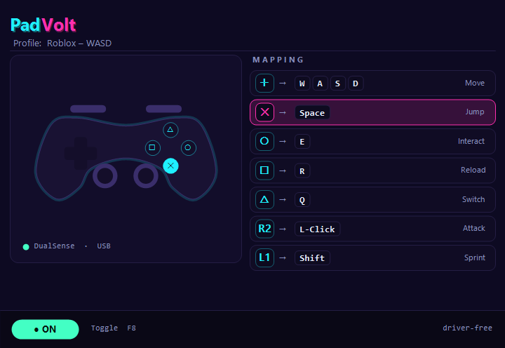

# PadVolt — Free Gamepad to Keyboard & Mouse Mapper for Windows

**Turn any gamepad into keyboard & mouse.** PadVolt maps buttons, D-pad and sticks from
your PlayStation, Xbox or generic controller to real keyboard keys and mouse actions —
so you can play PC games that don't support controllers, and drive any Windows app with
your pad. **Free, portable, driver-free, MIT open source.**

🌐 **Website:** https://padvolt.com
⬇️ **Download:** **[Latest release](../../releases/latest)** · Windows 10 / 11

## Why PadVolt

Plenty of PC games only accept keyboard and mouse — older titles, strategy / MOBA / MMO,
idle & clicker games, browser games, retro & emulators. If your controller does nothing
when you plug it in, PadVolt is the fix: it reads your gamepad and sends **real keyboard
and mouse input** to whatever game or app is currently focused.

## Features

- 🎮 **Any controller** — PlayStation (DualShock 4, DualSense), Xbox controllers, generic USB / Bluetooth gamepads work out of the box
- ⌨️ **Gamepad → keyboard & mouse** — buttons, D-pad, triggers and both analog sticks map to keys and mouse clicks
- 🧩 **No drivers** — nothing gets installed system-wide; the app is small and self-contained
- ⚡ **One-key toggle (F8)** — instantly turn mapping on / off from any window
- 🪶 **Fast & light** — small footprint, opens instantly, runs quietly in the background
- 🆓 **Free & open source** — MIT licensed, no account required, no ads, no telemetry

## Supported controllers

| Controller | Connection |
| --- | --- |
| PlayStation DualShock 4 (PS4) | USB / Bluetooth |
| PlayStation DualSense (PS5) | USB / Bluetooth |
| Xbox One / Series X / S controllers | USB / Bluetooth |
| Generic USB & Bluetooth gamepads | USB / Bluetooth |

## Perfect for

Any Windows game or app that reads keyboard & mouse but has **no native controller support**:

- Older & indie games
- Strategy, MOBA & MMO (RTS, Dota-likes, older MMOs)
- Idle & clicker games (auto-farm with controller triggers)
- Browser games & Flash-era ports
- Retro games & console emulators
- Everyday desktop apps you'd rather drive from the couch

## How to use

1. Download the latest installer from **[Releases](../../releases/latest)**
2. Run it — quick setup, single tiny app
3. Plug in your gamepad — PadVolt picks it up automatically
4. Press **F8** to enable mapping — controller now sends keyboard & mouse input
5. Press **F8** again to disable when you're done

## FAQ

**Is PadVolt free?**
Yes — free download, MIT licensed, no trial limit, no paid "Pro" tier, no account.

**Does it install drivers?**
No — it's a portable Windows app. Nothing is added to the system or persists after uninstall.

**Does it work with Steam / DS4Windows / X360CE?**
Yes — PadVolt sits above them. If Windows sees your controller (Game Controllers dialog),
PadVolt can map it.

**Does it work on Windows 11?**
Yes — Windows 10 and Windows 11 (x64).

**Which games?**
Any PC game / app that reads **keyboard and mouse**. Games with native controller support
don't need PadVolt.

## Compatibility

Windows 10 and Windows 11 (x64).

## License

[MIT](LICENSE) — free for personal and commercial use.

---

*Keywords: gamepad to keyboard, controller to keyboard, joystick to keyboard, gamepad mapper,
controller mapper, joystick mapper, keyboard emulator, gamepad emulator, xbox controller keyboard,
dualsense keyboard, ds4 keyboard, joytokey alternative, antimicrox alternative,
play games without controller support, use controller in strategy games, gamepad windows 11.*
